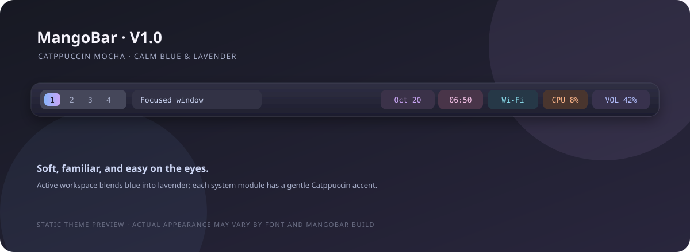
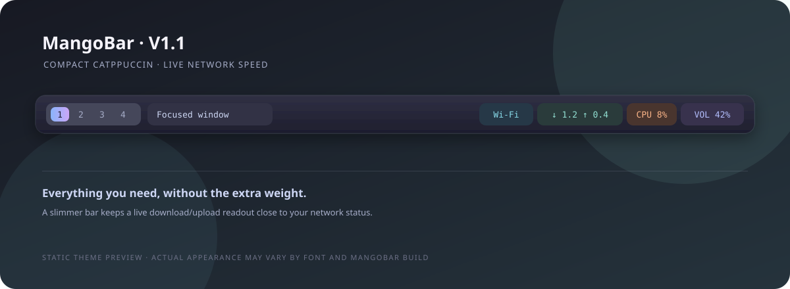
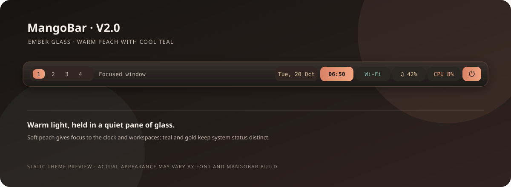
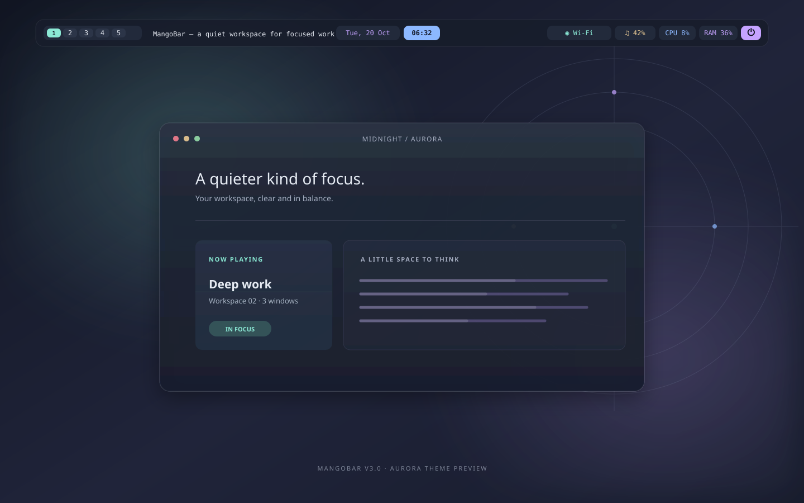

# MangoBar Themes

Themes and setup files for [MangoBar](https://github.com/mangowm/mangobar), the Wayland status bar for MangoWM.

## Install

Clone the repository and run the root installer:

```bash
git clone https://github.com/code-smith404/MangoBar-Themes.git
cd MangoBar-Themes
./install.sh
```

Choose V1.0, V1.1, V2.0, or V3.0 (Aurora) when prompted. The installer copies only the selected theme's files into `~/.config/mangobar/`.

## Theme previews

Each version has a separate preview image. These are static visual previews; the final appearance depends on your display, installed font, MangoBar build, and system status.

[Jump to: V1.0](#v10) · [V1.1](#v11) · [V2.0](#v20-under-development) · [V3.0 Aurora](#v30--aurora)

## V1.0

Stable Catppuccin-inspired theme:


[Open full-size V1.0 preview](previews/v1.0.svg)

- [Configuration](v1.0/config.jsonc)
- [Stylesheet](v1.0/style.css)

## V1.1

Compact update with a live network-speed indicator:


[Open full-size V1.1 preview](previews/v1.1.svg)

- [V1.1 setup guide](v1.1/README.md)
- [Configuration](v1.1/config.jsonc)
- [Stylesheet](v1.1/style.css)

## V2.0 (Under Development)

Experimental Arch Linux + MangoWM setup based on MangoBar's native JSONC configuration and styling support. Includes a compact bar with tags, active window title, centered date and time, network/audio/system modules, and a confirmed power menu.


[Open full-size V2.0 preview](previews/v2.0.svg)

- [V2.0 setup guide](v2.0%28Under%20Devlopment%29/README.md)
- [Configuration](v2.0%28Under%20Devlopment%29/config.jsonc)
- [Stylesheet](v2.0%28Under%20Devlopment%29/style.css)

The setup targets the currently published MangoBar documentation. No MangoBar binary or version is installed in this workspace, so the exact local runtime version could not be identified or launched here.

## V3.0 — Aurora

A polished midnight palette with soft cyan and violet accents, compact workspace pills, a highlighted clock, and a power menu.


[Open full-size V3.0 preview](v3.0/preview.svg)

- [V3.0 setup guide](v3.0/README.md)
- [Configuration](v3.0/config.jsonc)
- [Stylesheet](v3.0/style.css)
