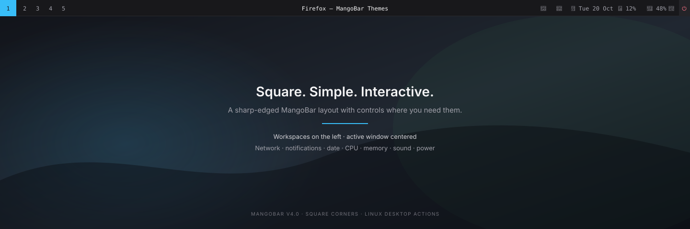

# MangoBar Themes

Themes and setup files for [MangoBar](https://github.com/mangowm/mangobar), the Wayland status bar for MangoWM.

## Install

Clone the repository and run the root installer:

```bash
git clone https://github.com/code-smith404/MangoBar-Themes.git
cd MangoBar-Themes
./install.sh
```

Choose V1.0, V1.1, V2.0, V3.0 (Lumen), or V4.0 (Square) when prompted. The installer copies only the selected theme's files into `~/.config/mangobar/`.

## Theme previews

Each version has a separate preview image. These are static visual previews; the final appearance depends on your display, installed font, MangoBar build, and system status.

[Jump to: V1.0](#v10) · [V1.1](#v11) · [V2.0](#v20-under-development) · [V3.0 Lumen](#v30--lumen) · [V4.0 Square](#v40--square)

## V1.0

Stable Catppuccin-inspired theme:


[Open full-size V1.0 preview](previews/v1.0.svg)

- [Configuration](v1.0/config.jsonc)
- [Stylesheet](v1.0/style.css)

## V1.1

Compact update with a live network-speed indicator:


[Open full-size V1.1 preview](previews/v1.1.svg)

- [V1.1 setup guide](v1.1/README.md)
- [Configuration](v1.1/config.jsonc)
- [Stylesheet](v1.1/style.css)

## V2.0 (Under Development)

Experimental Arch Linux + MangoWM setup using MangoBar's native Wayland bar, workspace integration, and active-window title. Midnight Lake centers the live window title and puts workspaces 1–4 on the left, with CPU, memory, Wi-Fi, volume, date, and time on the right. It includes a matching sunset wallpaper and no battery module.


[Open full-size V2.0 preview](previews/v2.0.svg)

- [V2.0 setup guide](v2.0%28Under%20Devlopment%29/README.md)
- [Configuration](v2.0%28Under%20Devlopment%29/config.jsonc)
- [Stylesheet](v2.0%28Under%20Devlopment%29/style.css)
- [Sunset wallpaper](v2.0%28Under%20Devlopment%29/wallpaper.svg)

The setup targets MangoBar's documented MangoWM integration and native modules. The MangoBar binary is not installed in this workspace, so it could not be launched here.

## V3.0 — Lumen

A dark, macOS-inspired menu bar with understated workspace and file controls, a compact system-status cluster, and no Apple logo.


[Open full-size V3.0 preview](v3.0/preview.svg)

- [V3.0 setup guide](v3.0/README.md)
- [Configuration](v3.0/config.jsonc)
- [Stylesheet](v3.0/style.css)

## V4.0 — Square

A sharp-cornered bar with workspaces on the left, the active window title centered, and icon-only network and sound indicators alongside notifications, date, CPU, memory, and power controls.


[Open full-size V4.0 preview](v4.0/preview.svg)

- [V4.0 setup guide](v4.0/README.md)
- [Configuration](v4.0/config.jsonc)
- [Stylesheet](v4.0/style.css)

The notification bell opens SwayNotificationCenter; network settings, a calendar, and a system monitor open when matching desktop applications are installed. The setup guide lists these optional integrations and how each bar control behaves.
