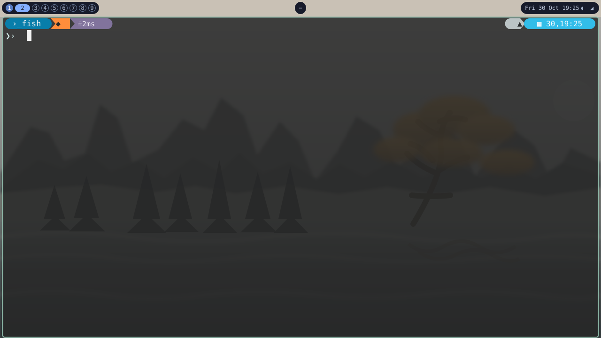

# MangoBar V3.0 — Mist Lake

A compact warm-toned panel inspired by the screenshot: nine rounded workspace indicators, a centered mark, and a blue date/time pill alongside audio and network icons. The matching preview recreates the dark translucent terminal window, mint frame, and misty lake wallpaper.



## Install

From the repository root, run the installer and choose **option 4**:

```bash
./install.sh
```

The installer copies the theme configuration, stylesheet, and menu helper scripts into `~/.config/mangobar/`.

To copy the files manually from the repository root:

```bash
mkdir -p "$HOME/.config/mangobar/scripts"
cp v3.0/config.jsonc v3.0/style.css "$HOME/.config/mangobar/"
install -m 755 v3.0/scripts/menu.sh v3.0/scripts/power-menu.sh \
    "$HOME/.config/mangobar/scripts/"
```

## Behavior

- Click a workspace number to activate it; right-click toggles it; scrolling switches through workspaces.
- Click audio to mute/unmute or scroll to adjust volume. Network, date, and time are native MangoBar modules.

## Font and colors

**JetBrainsMono Nerd Font** is recommended for the icon glyphs and compact monospace labels. Install it through your distribution's font packages; without Nerd Font, replace the icon strings in `config.jsonc` with glyphs available on your system.

Colors are defined at the top of `style.css`. `@bar` sets the warm panel, `@capsule` the dark pills, and `@accent` the active workspace and date/time color.
